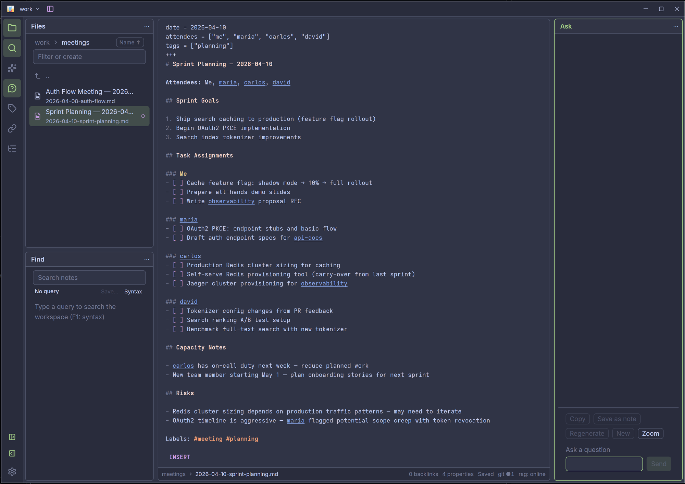
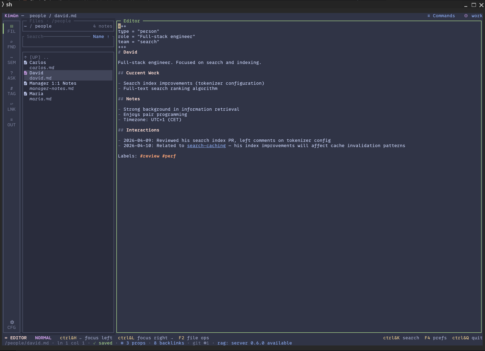

<div align="center">
  

  <h1>Kimün</h1>
  <p><strong>Simple note-taking. Fast, expressive search. AI-ready.</strong></p>

  <p>
    <a href="https://nico2sh.github.io/kimun/"></a>
    <a href="https://github.com/nico2sh/kimun/blob/main/LICENSE"></a>
    <a href="https://crates.io/crates/kimun-notes"></a>
    <a href="https://github.com/nico2sh/kimun/stargazers"></a>
    <a href="https://ratatui.rs/"></a>
  </p>

  <em><strong>Kimün</strong> (Mapudungun): Knowledge, learning, or wisdom.</em>
</div>

---

**Kimün** is a note-taking app with a desktop app and a terminal app. Both use the same notes. Your notes are plain Markdown files in a folder that you own, so Kimün works next to tools like Obsidian, Logseq, and QOwnNotes. Everything stays on your computer. There is no account and no tracking.

Kimün is in heavy development. A new version can break your configuration file or your custom themes. If the app does not start after an update, remove your configuration file. Kimün then creates a new one.

<div align="center">
  
</div>

---

## Quick Start

1. Install Kimün.

   On macOS and Linux, run this command in a terminal:

   ```bash
   curl -fsSL https://kimun.2co.dev/install.sh | sh
   ```

   On Windows, run this command in PowerShell:

   ```powershell
   irm https://kimun.2co.dev/install.ps1 | iex
   ```

2. Start the desktop app from your application menu, or type `kimun` in a terminal.
3. Follow the setup guide and choose a folder for your notes.
4. Optional: install the Kimün server for search by meaning and Ask. See [Semantic search and Ask](#semantic-search-and-ask-optional).

Then you can write:

- Press `Ctrl+K` to search.
- Press `Ctrl+W` to write a quick note.
- Type `[[` to link to another note, and `#` to add a tag.

To try Kimün with sample notes, clone this repository and run `kimun --config ./example/config.toml`.

For other ways to install, such as Homebrew, Cargo, or a direct download, see the [Installation page](https://nico2sh.github.io/kimun/getting-started/installation/).

---

## Documentation

The [documentation site](https://nico2sh.github.io/kimun/) has guides for both apps, search, themes, and the command line.

---

## Features

- Search: find notes by words, name, tag, link, or property. The search is local and fast.
- Links: use `[[wikilinks]]` and Markdown links. Backlinks show where a note is linked from.
- Properties: add facts such as `status` or `due` to a note, and search by them.
- Journal: press `Ctrl+J` for a note for today.
- Workspaces: keep separate notes folders, for example `personal` and `work`, and switch with `F5`.
- Vim keys: use the built-in vim mode, or your own Neovim, in the terminal app.
- Themes: choose from 67 built-in themes, or make your own.
- Command line: use `kimun` in scripts. For example, `kimun journal "Finished the deploy"` adds a line to today's journal.
- AI (optional): let an AI assistant read and write your notes through an [MCP server or a skill](https://nico2sh.github.io/kimun/using-kimun/ai/). The optional [Kimün server](server/README.md) adds search by meaning and Ask, which answers questions from your notes.

<div align="center">
  
</div>

---

## Main shortcuts (terminal app)

| Shortcut | What it does |
| --- | --- |
| `Ctrl+K` | Search your notes |
| `Ctrl+O` | Find a note by name |
| `Ctrl+B` | Start a command sequence. For example, `Ctrl+B` then `f b` opens the backlinks |
| `Ctrl+N` | Follow the link under the cursor |
| `Ctrl+T` | Show or hide the side panel |
| `Ctrl+W` | Write a quick note |
| `Ctrl+J` | Open today's journal |
| `F5` | Switch workspace |

Press `F1` in the app for help. The desktop app has its own [shortcuts](https://nico2sh.github.io/kimun/using-kimun/desktop-app/#shortcuts).

---

## AI assistants

An AI assistant can search, read, and edit your notes. Kimün saves a backup of the old text before a change.

To add the MCP server to Claude Code, run this command one time:

```bash
claude mcp add kimun -- kimun mcp
```

To use the skill instead, copy it to the skills folder of your tool:

```bash
cp -r skills/kimun-cli ~/.claude/skills
```

The [documentation](https://nico2sh.github.io/kimun/using-kimun/ai-mcp-server/) has setup steps for other tools.

---

## Semantic search and Ask (optional)

The Kimün server finds notes by meaning and answers questions from your notes. It can run fully on your computer. To install it and start it at login, run this command:

```bash
curl -fsSL https://kimun.2co.dev/install-server.sh | sh -s -- --service
```

Then open Preferences, go to Server, and enter `http://localhost:7573`. The first start downloads a model of a few hundred MB, so wait a minute. The [server README](server/README.md) has the Docker and Cargo installs, and the settings.

The script works on Linux and on macOS with Apple silicon. On Windows, run the server with Docker, or inside WSL2 with the same command. There is no Windows install script.

To update the server, run the same command again. The desktop app also offers an `Update now` button when you installed the server with `--service` on the same computer.

---

## Contributing

To send a fix or an improvement:

1. Fork the repository.
2. Create a branch (`git checkout -b feature/amazing-idea`).
3. Commit your changes (`git commit -m 'feat: Add amazing feature'`).
4. Push the branch (`git push origin feature/amazing-idea`).
5. Open a Pull Request.

---

## Credits

Kimün uses these projects and libraries, and took ideas from them:

- UI: [Ratatui](https://github.com/ratatui/ratatui).
- Search: [Nucleo](https://github.com/helix-editor/nucleo) for fuzzy matching, and [ignore](https://github.com/BurntSushi/ripgrep/tree/master/crates/ignore) for directory walking.
- Editor integration: [nvim-rs](https://github.com/KillTheMule/nvim-rs) for Neovim synchronization.
- Inspiration: [Obsidian](https://obsidian.md/), [Logseq](https://logseq.com/), and [QOwnNotes](https://www.qownnotes.org/).

---
